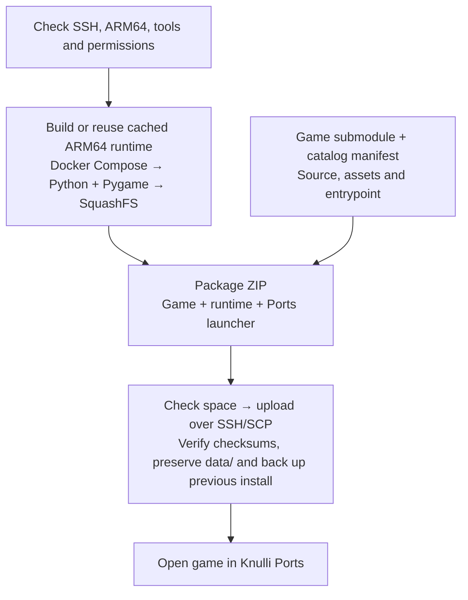

# py2ports

Package Python/Pygame games for **ARM64 Knulli handhelds** and install them with
one command. Each game stays in its own Git repository; its ZIP includes the
runtime and Ports launcher.

## Deploy to your handheld

**You need:** Python 3.11+, Git, Make, SSH/SCP, and Docker with Compose running.
Enable SSH on your handheld and connect it to the same network as your computer.

**The included [Pygame template](https://github.com/OscarJHernandez/py2port_pygame_template)
is private** and requires repository access. Without access, [add your own game](#add-your-own-game).

```sh
git clone --recurse-submodules https://github.com/OscarJHernandez/py2ports.git
cd py2ports
make setup
make deploy GAME=py2port_pygame_template
```

The default connection is `root@knulli`. To check it without building or installing:

```sh
make check-device
```

If `knulli` cannot be found, use the IP from the handheld's network menu:

```sh
make check-device DEVICE_HOST=192.168.1.50
make deploy GAME=py2port_pygame_template DEVICE_HOST=192.168.1.50
```

The first runtime build takes longer; later deployments reuse cached builds.
Allow roughly **1 GiB free** for the example's initial installation; upgrades
need extra space for a backup. Deployment checks available storage before uploading.

After installation, open **Ports → py2port_pygame_template**. Game logs:
`/userdata/roms/ports/py2port_pygame_template/log.txt`.

## How it works

For `make deploy GAME=<id>`:



Device checks run **before building**. The handheld needs no development tools
or internet connection. Graphics, controls and audio still need hardware testing.

## Useful commands

| Command | Purpose |
| --- | --- |
| `make list` | Show registered games |
| `make validate GAME=<id>` | Check a game's manifest and pinned source |
| `make package GAME=<id>` | Build and create `dist/<id>.zip` without deploying |
| `make deploy` | Install already packaged games |
| `make test` | Run tests without contacting a handheld |

## Add your own game

Clone py2ports **without** `--recurse-submodules`, then run `make setup`.
Register your game repository with its Python entrypoint:

```sh
.venv/bin/py2ports add https://github.com/YOU/YOUR-GAME.git \
    --name my_game --entrypoint src/main.py
# Review catalog/my_game.toml to select source files and assets.
make deploy GAME=my_game
```

To start with a playable demo, use the private template's **Use this template**
button and register the new repository with `--entrypoint src/run.py`.

## More information

- [Guide](docs/GUIDE.md): SSH settings (`DEVICE_HOST`, `DEVICE_USER`, `DEVICE_PORT`),
  troubleshooting, manifests, desktop play, runtime dependencies and releases.
- [Contributing](CONTRIBUTING.md) · [Verification results](docs/VERIFICATION.md)
- [MIT license](LICENSE) for platform code · [Dependency notices](THIRD_PARTY_NOTICES.md)

Games and dependencies retain their own licenses. The private template requires
separate authorization for public redistribution; release publication defaults
to disabled. py2ports is unofficial and is not affiliated with Knulli.
