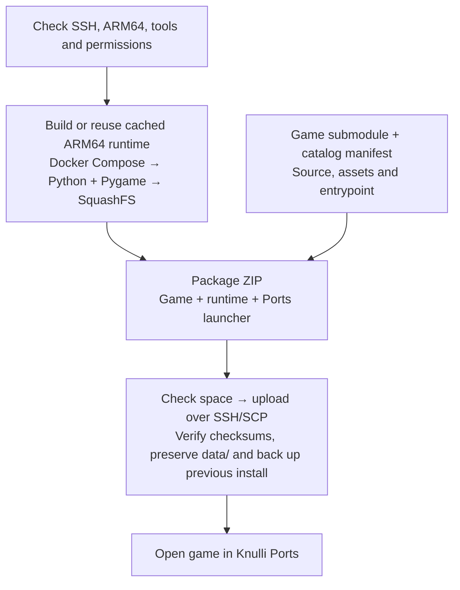

# py2ports

Package Python/Pygame games for **ARM64 Knulli handhelds** and install them with
one command. Each game stays in its own Git repository; its ZIP includes the
runtime and Ports launcher.

## Deploy to your handheld

**You need:** Python 3.11+, Git, Make, SSH/SCP, and Docker with Compose running.
Enable SSH on your handheld and connect it to the same network as your computer.

Snake, Breakout and the [Pygame template](https://github.com/OscarJHernandez/py2port_pygame_template)
are public and MIT-licensed. No private repository access is needed.

```sh
git clone --recurse-submodules https://github.com/OscarJHernandez/py2ports.git
cd py2ports
make setup
make deploy GAME=py2ports_snake
make deploy GAME=py2ports_breakout
```

The default connection is `root@knulli`. To check it without building or installing:

```sh
make check-device
```

If `knulli` cannot be found, use the IP from the handheld's network menu:

```sh
make check-device DEVICE_HOST=192.168.1.50
make deploy GAME=py2ports_snake DEVICE_HOST=192.168.1.50
```

The first runtime build takes longer; later deployments reuse cached builds.
Allow roughly **1 GiB free** for each game's initial installation; upgrades
need extra space for a backup. Deployment checks available storage before uploading.

After installation, open **Ports → py2ports_snake** or **py2ports_breakout**.
Logs are at `/userdata/roms/ports/<game-id>/log.txt`.

| Game | Play |
| --- | --- |
| [Snake](https://github.com/OscarJHernandez/py2ports_snake) | Eat, grow and fill the board. D-pad / stick / arrows / WASD to turn. |
| [Breakout](https://github.com/OscarJHernandez/py2ports_breakout) | Clear three levels with three lives. Left/right to move; A / Enter to launch. |

Both games: **A / Enter** to play, **Start / P** to pause, **B / Esc** to go back.
Prefer a ZIP without Docker? See [manual installation and checksums](docs/GUIDE.md#install-a-zip-manually).
Release publication remains manual; CI prepares downloadable public game artifacts.

## How it works

For `make deploy GAME=<id>`:



Device checks run **before building**. The handheld needs no development tools
or internet connection. Graphics, controls and audio still need hardware testing.

## Useful commands

| Command | Purpose |
| --- | --- |
| `make list` | Show registered games |
| `make validate GAME=<id>` | Check a game's manifest and pinned source |
| `make package GAME=<id>` | Build and create `dist/<id>.zip` without deploying |
| `make deploy` | Install already packaged games |
| `make test` | Run tests without contacting a handheld |

## Add your own game

Register your game repository with its Python entrypoint:

```sh
.venv/bin/py2ports add https://github.com/YOU/YOUR-GAME.git \
    --name my_game --entrypoint src/main.py
# Review catalog/my_game.toml to select source files and assets.
make deploy GAME=my_game
```

To start from the public movement demo, use the template's **Use this template**
button and register the new repository with `--entrypoint src/run.py`. Snake and
Breakout were both created this way.

## More information

- [Guide](docs/GUIDE.md): SSH settings (`DEVICE_HOST`, `DEVICE_USER`, `DEVICE_PORT`),
  troubleshooting, manifests, desktop play, runtime dependencies and releases.
- [Contributing](CONTRIBUTING.md) · [Verification results](docs/VERIFICATION.md)
- [MIT license](LICENSE) for platform code · [Dependency notices](THIRD_PARTY_NOTICES.md)

Games and dependencies retain their own licenses; check licenses when adding
new content. Release publication defaults to disabled. py2ports is unofficial
and is not affiliated with Knulli.
